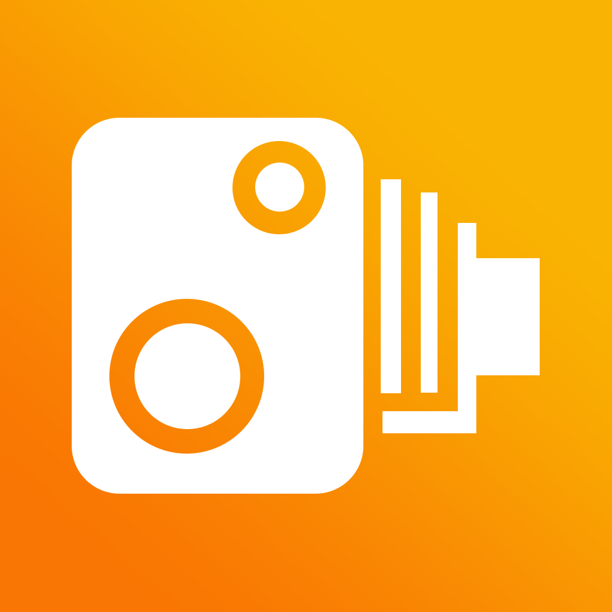
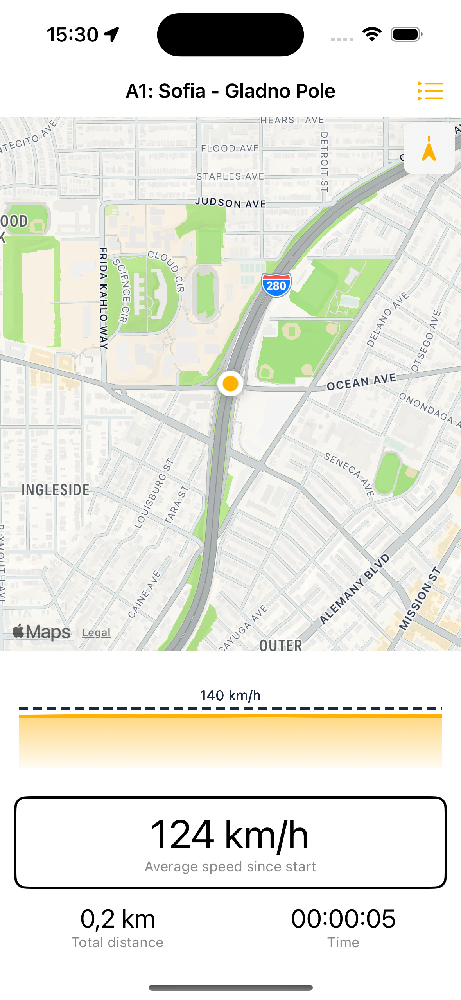
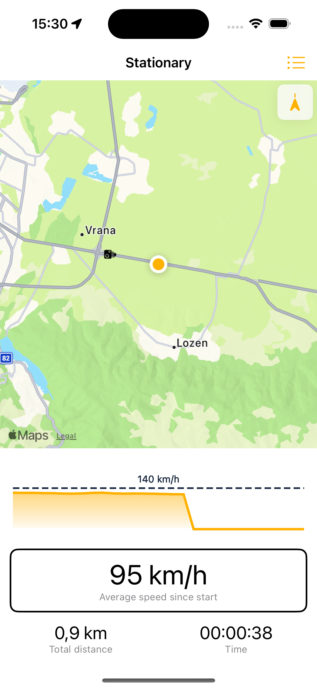
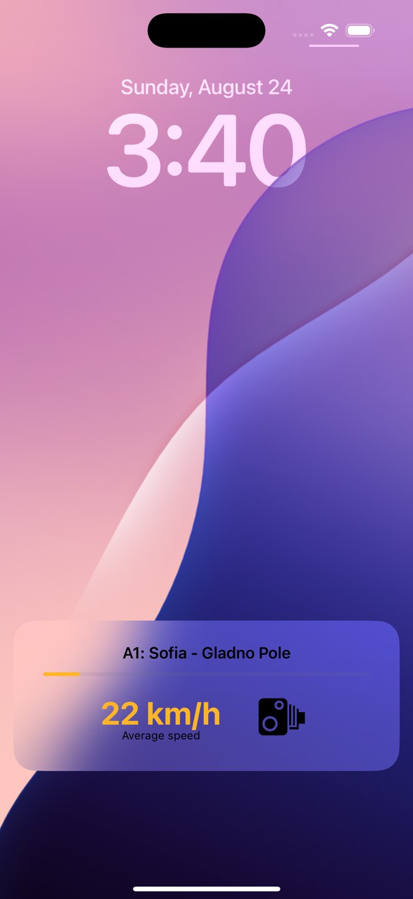
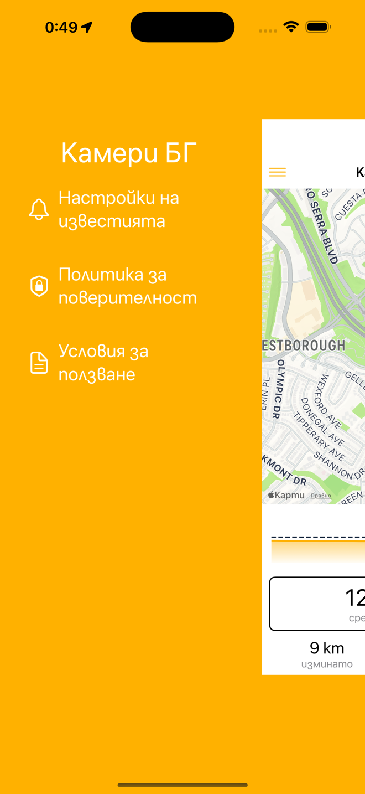

Камери БГ / Kameri BG
==

[Go to the website](https://riskoni.github.io/KameriBG/) · [Download on the App Store](https://apps.apple.com/app/6751439569)

Description
==

Kameri BG is an easy-to-use iPhone app that helps drivers stay within the limits of Bulgaria's average speed camera zones. It uses your phone's GPS to show the limit for the zone you're driving through and the speed to hold to finish it within the limit. The app works entirely offline and does not collect any data. Your trips and history stay on your phone.

New in version 2.0
==

- **CarPlay** – live speed, average speed, nearby zones and history on your car's display (one-time purchase)
- **Safe speed** for the rest of the zone, on the main screen, in CarPlay and on the Lock Screen (Live Activity)
- **Alerts** about 1 km before every zone, and **spoken alerts in Bulgarian**
- **Siri and Shortcuts** – ask for your average speed or the distance to the end of the zone, hands-free
- A new full-screen map, more accurate zone detection and saved trip history

Application Screenshots
==

  
  
  
  

